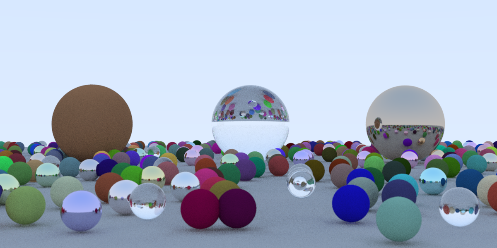

# raytracing-gossamer

Ray Tracing in One Weekend in [Gossamer](https://github.com/gossamer-lang/gossamer),
ported from the [`optimized`](https://github.com/aguspiza/raytracing-nim/tree/optimized)
branch of raytracing-nim. It writes the same `ray.tga` as that branch,
[raytracing-goose](https://github.com/aguspiza/raytracing-goose) and
[raytracing-bend2](https://github.com/aguspiza/raytracing-bend2), byte for byte
(sha256 checked at 1 and 4 samples per pixel).



The `main` branch is the first port, from raytracing-nim's
`fix-threads-and-cross`: an enum per material, a `World` of `Sphere` records,
`Option<Hit>`, and its own random numbers, so its image differs.

## Run

```
gos test
./test.sh                 # ray.tga byte-identical to Nim, Goose and Bend
gos build --release      # native binary; needs LLVM 18-22 (opt, llc)
./target/release/raytracing-gossamer          # 64 samples per pixel -> ray.tga
./target/release/raytracing-gossamer 16 ppm   # 16 samples, also ray.ppm (P3)
```

There is no `--threads`: `par_chunks_mut` runs on every core and gos 0.76 has
no setting for its worker count.

## Layout

- `src/vec3.gos`: `Vec3` with operator impls.
- `src/seed.gos`: the per-pixel xorshift32 state of the Bend port, as methods
  of `Seed` (`next`, `unit`, `point3`, `in_sphere`, ...).
- `src/scene.gos`: `Material` (an enum), `Scene` as flat `f32` arrays
  (`cx`, `cy`, `cz`, `r2`) with the two-pass hit test, and `Camera`.
- `src/image.gos`: TGA and PPM encoders.
- `src/main.gos`: the color loop, one row per `par_chunks_mut` chunk.

## Timing

1200x600, Ryzen 7 5700U (16 threads), median of 3 runs. Nim, Goose and
Gossamer run natively on Windows 11; Bend runs in WSL2 on the same machine.

- Nim 2.2.10 with MinGW gcc 15.2, `optimized` branch and its `config.nims`
  (`-d:danger --panics:on -march=native`).
- Goose v2026.3, emitted C built with gcc 15.2 `-O3 -march=native`.
- Gossamer 0.76.0, `gos build --release` (LLVM `-O3`). Its "1 thread" row
  pins the process to one core.
- Bend 2.0.39, `bend main.bend -o ray`.

| 4 samples per pixel  | Wall time | Peak RAM |
| -------------------- | --------- | -------- |
| Nim, 1 thread        | 2.46 s    | 14 MB    |
| Nim, 16 threads      | 0.45 s    | 14 MB    |
| Goose, 1 thread      | 2.20 s    | 8 MB     |
| Goose, 16 threads    | 0.35 s    | 8 MB     |
| Gossamer, 1 core     | 16.9 s    | 19 MB    |
| Gossamer, 16 threads | 2.66 s    | 19 MB    |
| Bend, 1 thread       | 28.6 s    | 48 MB    |
| Bend, 16 threads     | 4.34 s    | 48 MB    |

| 64 samples per pixel, 16 threads | Wall time |
| -------------------------------- | --------- |
| Nim                              | 5.17 s    |
| Goose                            | 5.35 s    |
| Gossamer                         | 41.9 s    |
| Bend                             | 76.4 s    |

Gossamer is about 7 times slower than Nim and Goose with the same data layout,
and about twice as fast as Bend.

## Why Gossamer is slower here

The layout is the one Nim and Goose use; the gap is in the code gos 0.76
generates for it.

- **`f32` arithmetic costs about 3 times `f64`.** A loop of 512 `acc += x * k`
  takes 1,069 ns in `f32`, 367 ns in `f64`, and 340 ns as the same loop in C
  (`f32`, gcc `-O3`). The `f32` results are exact (the image matches to the
  byte), but each operation seems to go through `f64`. The whole renderer in
  `f64` renders a row in half the time, but it no longer writes the same image,
  so this port keeps `f32`.
- **The hit test is not vectorized.** gcc turns Nim's and Goose's first pass
  into AVX code, 8 spheres at a time. In Gossamer the index checks stay in the
  loop (`GOS_BOUNDS_REMARKS=1` reports `checked_fallbacks=4` in `Scene::hit`),
  and the loop stays scalar: 2.8 µs per ray over 486 spheres, about 5.7 ns per
  sphere. Writing the first pass with `Simd<f32, 8>` or `Simd<f64, 4>` by hand
  gave the same time, so the hit test stays in plain code.
- **Parallel scaling is 6.3x on 16 threads** (Nim: 5.5x, Goose: 6.3x).

## Compile time

A full build from source, median of 3 runs. For Gossamer, `gos cache --clear
--scope all` first: gos keeps LLVM objects in a global cache, and without
clearing it a "clean" build takes 0.3 s. The compiler's peak RAM is that of
the driver process (`nim`, `goose` then `gcc`, `gos`), without the processes it
starts (`cc1`, `opt`, `llc`); for Bend it is GNU time's peak.

| Build                              | Wall time | Compiler peak RAM |
| ---------------------------------- | --------- | ----------------- |
| Gossamer, `gos build --release`    | 0.8 s     | 36 MB             |
| Goose, emit C and gcc `-O3`        | 1.7 s     | 12 MB             |
| Bend, full build (`-o ray`)        | 2.6 s     | 138 MB            |
| Nim `optimized`, `nim c -f`        | 3.5 s     | 97 MB             |

`gos build` runs LLVM's `opt` and `llc` per object, in parallel.

## Binary size

| Executable, stripped | Size     |
| -------------------- | -------- |
| Goose                | 75 KB    |
| Bend `ray`           | 119 KB   |
| Nim `optimized`      | 186 KB   |
| Gossamer             | 1,649 KB |

Gossamer links its whole runtime (scheduler, reference counting, the
standard library the program reaches) into every binary.

## Memory

19 MB peak: the 2.2 MB image as `Rgb` values, the 2.2 MB targa built from it,
the scene (486 spheres in six arrays) and the runtime with one worker per core.
Values are reference counted; nothing in the render loop allocates.

## Notes on gos 0.76

- A free function from another file (or `mod`) called inside a `par_*`
  callback is reported as impure (GT0090), even when it only does arithmetic.
  Methods are fine, so the random numbers are methods of `Seed` and the hit test
  is `Scene::hit`.
- Dereferencing a `std::flag` value inside the `par_chunks_mut` callback hangs
  the program; read it into a plain binding before.
- `std::math::rand::Rng` is native code, so a `par_*` callback cannot use it.
